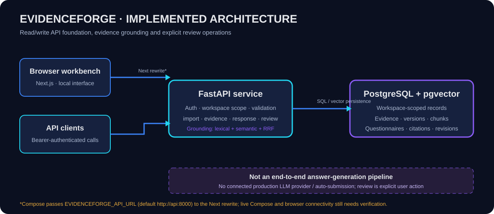
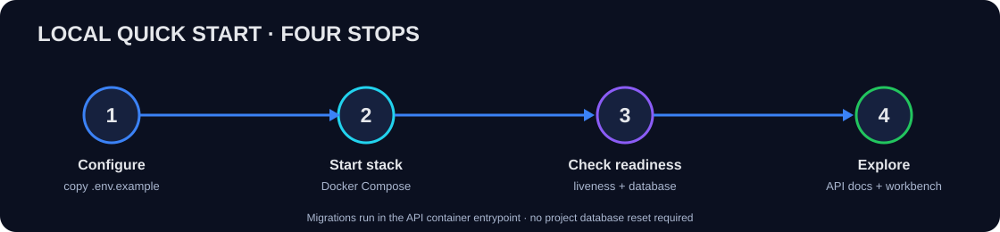
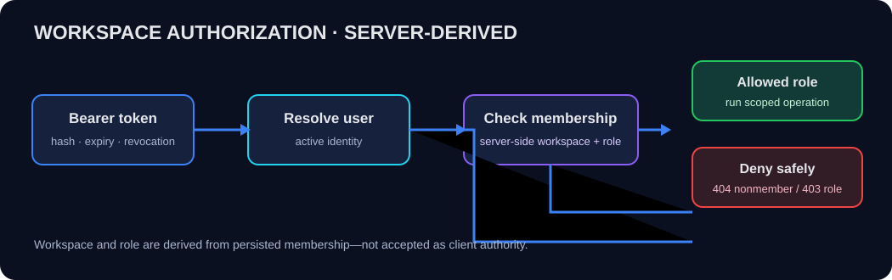
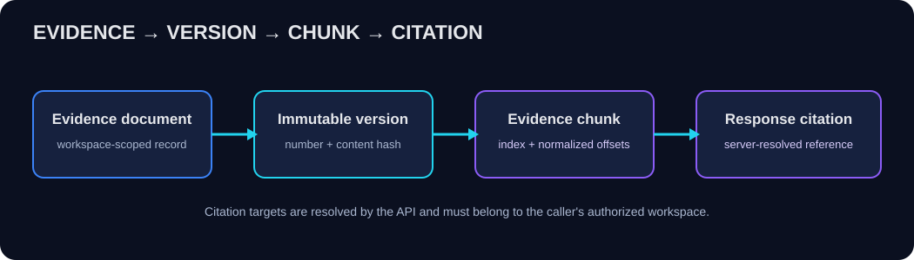
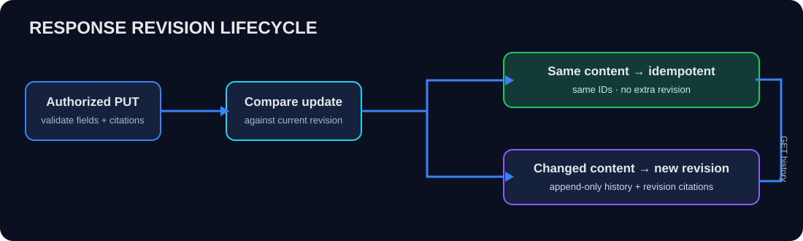

# EvidenceForge

**Evidence first. Answers second.**

A local-first workbench for security-questionnaire evidence, provenance, retrieval, and review.

**Workspace isolation** · **XLSX import** · **Evidence provenance** · **Hybrid grounding** · **Response history**

[Quick start](#quick-start) · [Problem and foundation](#the-problem-and-the-foundation) · [Architecture](#architecture) · [API reference](#api-reference) · [Limitations](#current-status-and-limitations)

EvidenceForge organizes security-questionnaire questions alongside workspace-scoped evidence and citations. It imports questionnaire workbooks, stores versioned evidence, grounds a question against evidence candidates, and persists cited response revisions with authorization and validation checks. It is a development workbench—not a compliance certification, autonomous answer system, or automatic submission tool.



> **Documentation provenance and publication status:** The original audit behind this guide inspected public `main` at commit `027e104`. Local demo outcomes listed below were supplied for that documentation task; they are not production validation. The redesign was subsequently applied locally, committed as [`5eacc0fc5cda4ea8436eafabd47b68f154708c9a`](https://github.com/SadashivPole/evidenceforge/commit/5eacc0fc5cda4ea8436eafabd47b68f154708c9a), and pushed to public `main`. Its [GitHub Actions CI run](https://github.com/SadashivPole/evidenceforge/actions/runs/38136621746) passed the **Backend**, **Backend PostgreSQL concurrency**, and **Frontend** jobs. Those later actions do not expand the original audit scope or turn supplied demo outcomes into production validation.

## Contents

- [What it is](#what-it-is)
- [The problem and the foundation](#the-problem-and-the-foundation)
- [Implementation status](#implementation-status)
- [Architecture](#architecture)
- [Workflow](#workflow)
- [Repository map](#repository-map)
- [Technology stack](#technology-stack)
- [Prerequisites](#prerequisites)
- [Quick start](#quick-start)
- [Configuration](#configuration)
- [API reference](#api-reference)
- [Authentication and workspace security](#authentication-and-workspace-security)
- [Evidence, citations, and revisions](#evidence-citations-and-revisions)
- [Synthetic local demonstration](#synthetic-local-demonstration)
- [Retrieval benchmark context](#retrieval-benchmark-context)
- [Testing and quality checks](#testing-and-quality-checks)
- [Troubleshooting](#troubleshooting)
- [Current status and limitations](#current-status-and-limitations)
- [Contributing safely](#contributing-safely)
- [FAQ](#faq)
- [Glossary](#glossary)
- [Further reading](#further-reading)

## What it is

Security and compliance teams repeatedly answer questions about controls, policies, and procedures. The supporting material changes over time and may live in separate documents. An answer that cannot be traced to the evidence and version that support it is difficult to verify later.

EvidenceForge is a developer-oriented foundation for organizing this work. A **workspace** is the tenant-like boundary for a team's questionnaires, evidence, and responses. A **citation** is a server-resolved reference to an evidence chunk—not text supplied by a client and trusted without checking. The API keeps the response, evidence provenance, workspace membership, and revision history connected.

Today, a developer can import XLSX questionnaire data, ingest supported evidence files, retrieve workspace-authorized evidence candidates, save a response with citations, and inspect its history. The frontend is a focused grounding and response workbench; it does not provide a full questionnaire import/admin product experience.

### The problem and the foundation

| Manual process | EvidenceForge foundation |
|---|---|
| Questions and source documents are handled separately. | Questionnaire versions and evidence versions are persisted. |
| An answer can lose its source when copied or edited. | Citation records resolve to evidence document/version/chunk metadata. |
| Approval can be treated as a label in client input. | Status-specific validation and role checks run server-side. |
| A changed response can obscure the earlier one. | Changed updates append immutable response revisions; identical updates are idempotent. |
| A resource identifier can be guessed across teams. | Workspace access derives from the authenticated user's membership; cross-workspace references are rejected. |

These are intended workflow benefits, not measured time savings or a security certification.

## Implementation status

Statuses describe what is present in the inspected source and what has evidence in the supplied local synthetic demo. **Implemented** means code exists; **Verified locally** is reserved for the concrete demo outcomes supplied with this request. No full test suite was executed as part of preparing this document.

| Capability | Current status | What it does | Verification or limitation |
|---|---|---|---|
| Workspace, membership, roles, bearer authentication | Implemented | Protects tenant-scoped APIs using database-backed opaque bearer tokens and membership-derived authorization. | Cross-workspace behavior and MEMBER denial are in supplied local demo; not an external audit. Token provisioning is outside the public API. |
| XLSX questionnaire import/versioning | Implemented | Deterministic workbook parsing, normalization, question identity, persistence, and import results. | One-question synthetic import returned HTTP 200/version 1 in the supplied demo. |
| Evidence documents, versions, chunks | Implemented | Uploads supported evidence, normalizes/chunks content, persists hashes and locations. | Source includes size/type validation and persistence; inspect route limitations and use synthetic files. |
| Citation association and validation | Implemented | Resolves chunk IDs to workspace-owned evidence and stores provenance on response revisions. | Valid and cross-workspace citation cases are in the supplied local demo. |
| Deterministic lexical + semantic hybrid grounding with RRF | Implemented | Grounding API combines lexical and semantic candidate retrieval and reciprocal-rank fusion (RRF); retrieval is not answer generation. | Source routes question grounding through the hybrid retriever; use a configured/available embedding path and benchmark/test the actual environment. |
| Response persistence, approval, idempotency, revisions | Implemented | Stores one logical response per question with immutable revisions and citation records. | Supplied local demo covers MEMBER rejection, citation validation, idempotency, revision 2, and history. |
| Explicit human review action | Implemented, not a complete review product | API and workbench support explicit accept/approve/edit-and-approve/reject operations against grounded context. | Source includes route/service/UI integration; not an autonomous reviewer or a broad production review console. |
| Liveness and readiness | Implemented | Liveness reports process state; readiness checks database connectivity. | Supplied local demo reports HTTP 200 for both, database `ok` for readiness. |
| Frontend | Partial workbench | Next.js screen accepts resource IDs/token, runs grounding, loads/saves responses, and presents review operations. | Not a complete administration/import/export experience. Compose proxy variable mismatch is noted under [Troubleshooting](#troubleshooting). |
| LLM answer generation | Not implemented end to end | Provider-neutral contracts and validation/evaluation scaffolding exist, but no configured production answer-generation request workflow is exposed. | Mock evaluation components are not a shipped generation service. |
| Export / automatic submission / chatbot | Planned or absent | Not present as completed product capabilities. | Do not infer from design documents. |

## Architecture

The hero diagram above is the architecture overview; it is shown once to keep the page concise.

- **Next.js workbench:** a focused UI for grounding, selecting candidate citations, working with persisted responses, and explicit review actions.
- **FastAPI:** owns HTTP contracts, bearer authentication, workspace membership checks, validation, persistence, audit events, and grounding orchestration.
- **PostgreSQL:** stores workspaces, memberships, questionnaire imports/versions/questions, evidence metadata/versions/chunks, responses/revisions/citations, and audit records.
- **pgvector:** stores embedding records used by semantic retrieval. Embedding generation/backfill is an explicit service path; local availability/model setup must be verified before semantic behavior is relied on.
- **Grounding:** server-side retrieval returns evidence candidates with provenance. It does not synthesize a questionnaire answer.

The architecture SVG intentionally excludes an online LLM provider, automatic export, or automatic questionnaire submission.

## Workflow

1. Configure a local `.env` and start the Compose stack.
2. Confirm API liveness and database readiness.
3. Create/identify a workspace and import a synthetic XLSX through the import API.
4. Create an evidence document, upload a supported synthetic file version, and inspect its chunks.
5. Identify a questionnaire version question and call its grounding route to retrieve authorized candidates.
6. Submit a response update with a status and evidence chunk IDs. The server checks workspace membership, status rules, roles, and citations.
7. Repeat the exact update to confirm idempotency; change the answer to create a new revision; fetch response history.
8. For explicit review, use the review route/workbench operation on grounded context. This is a human-triggered operation, not model-generated approval.
9. Run tests and record the result from your local environment; do not copy results from another run.



## Repository map

```text
.
├── .github/workflows/ci.yml       # CI jobs for Python, PostgreSQL test, and frontend checks
├── .env.example                   # Safe local configuration template; do not put secrets in README
├── compose.yaml                   # db, api, and web services
├── backend/
│   ├── app/api/routes/            # Health, workspaces, evidence, import, grounding, responses, review
│   ├── app/api/schemas.py         # Pydantic request and response contracts
│   ├── app/auth.py                # Bearer authentication and membership/role checks
│   ├── app/evidence/              # Ingestion, chunking, embeddings, retrieval, citations, context
│   ├── app/questionnaires/        # XLSX, persistence, grounding, response, generation boundary, review
│   ├── app/models.py              # Core relational models and roles
│   ├── app/main.py                # FastAPI app and router registration
│   ├── migrations/versions/       # Alembic database schema history
│   ├── tests/                     # API, unit, PostgreSQL and evaluation tests
│   └── pyproject.toml             # Python requirements and Ruff/mypy/pytest settings
├── docs/                          # Architecture, threat model, evaluation and design records
└── frontend/
    ├── app/                       # Next.js workbench interface
    ├── next.config.mjs            # Browser API proxy rewrite
    └── package.json               # Frontend scripts and dependencies
```

The source tree above summarizes tracked, relevant areas; local experimental files may exist in your checkout and should be preserved when applying documentation updates.

## Technology stack

| Technology | Use | Basic local setup? |
|---|---|---|
| Python 3.11+ | Backend package declares `requires-python >=3.11`; CI config uses Python 3.12; API image is Python 3.13. | Needed for local backend/tests; Docker uses its image. |
| FastAPI + Pydantic | HTTP API, dependency injection, request/response validation. | Included in API container; Python development install for local tests. |
| SQLAlchemy + Alembic | Relational persistence and versioned schema migrations. | Used by API container and backend tests. |
| PostgreSQL 16 + pgvector | Compose database and vector column support; image is `pgvector/pgvector:0.8.6-pg16`. | Required for Compose and PostgreSQL integration tests. |
| psycopg 3 | PostgreSQL driver. | Backend dependency. |
| openpyxl | XLSX questionnaire workbook processing. | Backend dependency. |
| sentence-transformers | Explicit local embedding model path. | Package dependency; actual model loading/download is optional to basic app startup and required only when invoking the embedding path. |
| Next.js 16 / React 19 | Browser workbench. | Required only for frontend development outside Docker; Compose builds it. |
| pytest, Ruff, mypy, httpx | Backend testing and quality tooling. | Install with `backend[dev]`. |
| npm, ESLint, Prettier, TypeScript | Frontend dependency and quality workflow. | Frontend checks; use Node.js 24 LTS as CI does. |

Versions above reflect project metadata, image tags, and CI configuration inspected at `027e104`; they are not a compatibility guarantee for every host.

## Prerequisites

- Windows with PowerShell and Docker Desktop/Compose for the documented Compose path.
- Python 3.11 or later for local backend tools (CI uses Python 3.12).
- Node.js 24 LTS and npm for frontend checks outside Docker.
- Network access for initial container/package/model downloads as needed.
- Ports **8000** (API) and **3000** (web) available. PostgreSQL is not published to a host port by `compose.yaml`.
- PostgreSQL/pgvector is supplied by Compose; no separate host database is required for the basic stack.

## Quick start

The API container runs `alembic upgrade head` before starting Uvicorn. Starting the stack therefore applies migrations automatically; do not run an undocumented second migration process.

From PowerShell:

```powershell
# Run these commands from the root of your cloned repository.
python --version
docker --version
docker compose version
```

Create a local `.env` from the tracked template. Replace the placeholder password with a unique local-only value, and make `POSTGRES_PASSWORD` and the password embedded in `DATABASE_URL` match. Keep `.env` private and untracked.

```powershell
Copy-Item .env.example .env
notepad .env
```

Build and start services in the background:

```powershell
docker compose up --build -d
docker compose ps
```

Check liveness, readiness, and API docs:

```powershell
Invoke-RestMethod http://localhost:8000/health/live
Invoke-RestMethod http://localhost:8000/health/ready
```

Open `http://localhost:8000/docs` for FastAPI's generated API documentation and `http://localhost:3000` for the web workbench. The frontend currently needs workspace, questionnaire, version, and question identifiers plus a bearer token; it is not a guided onboarding/import UI.

### First-run authentication prerequisite

The repository provides an operator-only, one-time first-user bootstrap CLI; it does not expose a public registration or token-issuance endpoint. See the [First-user bootstrap operator runbook](docs/bootstrap-operator-runbook.md) for the guarded provisioning procedure. A brand-new Compose database can start and answer public health requests, but protected API/workbench workflows require an authorized operator to run the bootstrap against the intended PostgreSQL database after migrations are current. The bootstrap creates the initial user, workspace, OWNER membership, hashed bearer-token record, and audit event. Afterward, `POST /workspaces` can create additional workspaces for the authenticated caller; OWNER/ADMIN can add an already-existing user through the membership route.

Use the [First-user bootstrap operator runbook](docs/bootstrap-operator-runbook.md) for the supported clean-machine procedure to create the first local user, workspace, owner membership, and token. The protected request examples below require that one-time operator step before they can succeed against a fresh Compose database. The supported test-fixture path remains separate and is for tests only: `backend/tests/conftest.py` creates a temporary user, random bearer token, and workspace owner membership in an in-memory SQLite test app. The tests keep that token in process and do not print it. Run the focused auth/security tests from the backend setup to exercise that test-only path:

```powershell
python -m pytest -q backend/tests/test_security_boundary.py
```

This does not provision an account or token in the Compose database. For a protected local API demo, follow the operator runbook and verify that the command targets the intended PostgreSQL database before proceeding. Do not create token rows manually or copy fixture tokens into the running app. Store the one-time token output securely and, when needed, pass it through a process-scoped environment variable such as `$env:TOKEN_ADMIN`; never echo it or commit it. The bootstrap creates the initial workspace and OWNER membership; verify authentication using `GET /workspaces` and confirm the bootstrap-created workspace is returned. Without completing the documented bootstrap procedure, treat protected API examples below as request templates only.

To inspect startup logs without tearing down services:

```powershell
docker compose logs --tail 100 api web db
```

### Local Python development (optional)

From the repository root, install the backend with development extras. Use a virtual environment per your team's local practices; these commands do not create or delete databases.

```powershell
python -m pip install -e "backend[dev]"
```

The `.env` `DATABASE_URL` uses the Compose service hostname `db`, suitable inside the container network. A host-run API needs a host-reachable PostgreSQL URL; Compose does not publish port 5432 in `compose.yaml`. Do not assume the container URL works from a host Python process.

### Questionnaire and evidence import sequence

These calls require the out-of-band auth prerequisite above; they are request templates, not runnable on a fresh Compose database. The importer accepts an XLSX multipart `file`. Evidence ingestion supports `.txt` and `.md` source files up to 5 MiB; use only synthetic material in a demo.

```powershell
$Base = 'http://localhost:8000'
$WorkspaceId = '<workspace-uuid-from-authorized-setup>'
$XlsxPath = 'C:\EvidenceForgeDemo\synthetic-questionnaire.xlsx'
$env:TOKEN_ADMIN = '<token-issued-through-approved-local-provisioning>'
curl.exe -sS -i -F "file=@$XlsxPath" -H "Authorization: Bearer $env:TOKEN_ADMIN" "$Base/workspaces/$WorkspaceId/questionnaires/import"
```

Create an evidence record by writing UTF-8 JSON, then upload a synthetic Markdown or text version. Replace IDs with values from genuine prior responses; this example does not assert their shape beyond the schemas documented by the API.

```powershell
$DocPayloadPath = Join-Path $env:TEMP 'evidenceforge-document.json'
$DocBody = @{ name = 'Synthetic access policy' } | ConvertTo-Json -Compress
[System.IO.File]::WriteAllText($DocPayloadPath, $DocBody, [System.Text.UTF8Encoding]::new($false))
curl.exe -sS -i -X POST "$Base/workspaces/$WorkspaceId/documents" -H "Authorization: Bearer $env:TOKEN_ADMIN" -H 'Content-Type: application/json' --data-binary "@$DocPayloadPath"

$DocumentId = '<document-uuid-from-real-response>'
$EvidencePath = 'C:\EvidenceForgeDemo\synthetic-access-policy.md'
curl.exe -sS -i -F "file=@$EvidencePath" -H "Authorization: Bearer $env:TOKEN_ADMIN" "$Base/workspaces/$WorkspaceId/documents/$DocumentId/versions"
```

After successful imports, use the returned questionnaire/version/question and evidence document/version/chunk IDs in the authorized list/read/grounding APIs. Fetch chunk IDs from `GET /workspaces/{workspace_id}/documents/{document_id}/versions/{version_id}/chunks`; ground the question, then submit a response. Use actual API responses to populate identifiers. No static UUIDs or fabricated response bodies are provided here.

## Configuration

`.env.example` is the source of truth for Compose configuration. The table explains its current variables; values below are names/purposes, not secrets.

| Variable | Required? | Purpose |
|---|---|---|
| `ENVIRONMENT` | No; defaults to `development` | Environment label passed to API container. |
| `LOG_LEVEL` | No; defaults to `INFO` | API log level. |
| `POSTGRES_DB` | Defaults to `evidenceforge` | Compose database name. |
| `POSTGRES_USER` | Defaults to `evidenceforge` | Compose database user. |
| `POSTGRES_PASSWORD` | Yes for Compose | Local database password; replace template value and keep private. |
| `DATABASE_URL` | Yes for Compose | SQLAlchemy/psycopg connection string. Match its password with `POSTGRES_PASSWORD`; use host `db` in Compose. |
| `EVIDENCEFORGE_API_URL` | No; Compose defaults to `http://api:8000` | Server-side destination used by the Next.js rewrite in `frontend/next.config.mjs`; the `api` hostname resolves to the API service on the Compose network. |


Never paste a real token/password into the README, terminal capture, or a committed configuration file.

## API reference

All protected operations use `Authorization: Bearer $TOKEN`. The opaque token is provisioned out of band; there is no public registration/token-issuance route. Initial provisioning is an operator-only, one-time operation; see the [First-user bootstrap operator runbook](docs/bootstrap-operator-runbook.md). The test fixture provisions ephemeral identities only inside isolated tests; see [First-run authentication prerequisite](#first-run-authentication-prerequisite). The API docs at `/docs` are generated from the running source and are the best place to inspect the complete schemas.

| Method | Route | Purpose | Auth / role notes | Success and relevant failures |
|---|---|---|---|---|
| `GET` | `/health/live` | Process liveness. | Public. | 200; no database dependency check. |
| `GET` | `/health/ready` | Database readiness. | Public. | 200 with database `ok`; 503 if DB unavailable. |
| `POST` | `/workspaces` | Create workspace and owner membership. | Authenticated. | 201; schema validation failures. |
| `GET` | `/workspaces` | List caller's memberships. | Authenticated. | 200. |
| `GET`, `PATCH` | `/workspaces/{workspace_id}` | Read/update workspace. | Membership; update is owner/admin. | 200; nonmember/unknown workspace hidden as 404; role denial 403. |
| `GET`, `POST` | `/workspaces/{workspace_id}/members` | List/add existing user memberships. | Member list requires membership; changes owner/admin. | 200/created response; role/validation errors. No public user registration. |
| `PATCH`, `DELETE` | `/workspaces/{workspace_id}/members/{user_id}` | Change role/remove membership. | Owner/admin; owner-only restrictions apply. | 200/204; 403, 404, or 409 if last owner would be removed. |
| `GET` | `/workspaces/{workspace_id}/audit-events` | List workspace audit events. | Workspace membership. | 200; workspace access checks apply. |
| `POST`, `GET` | `/workspaces/{workspace_id}/documents` | Create/list evidence documents. | Read requires membership; writes OWNER/ADMIN/MEMBER. | 201/200; duplicate name 409. |
| `POST` | `/workspaces/{workspace_id}/documents/{document_id}/versions` | Upload, normalize, chunk and persist version. | OWNER/ADMIN/MEMBER. | 201 new or 200 duplicate; 404, 413, 415, 422 on documented failure classes. |
| `GET` | `/workspaces/{workspace_id}/documents/{document_id}` | Read one document. | Membership. | 200 or 404. |
| `GET` | `/workspaces/{workspace_id}/documents/{document_id}/versions` | List versions. | Membership. | 200 or 404. |
| `GET` | `/workspaces/{workspace_id}/documents/{document_id}/versions/{version_id}` | Read version. | Membership. | 200 or 404. |
| `GET` | `/workspaces/{workspace_id}/documents/{document_id}/versions/{version_id}/chunks` | Read chunks for version. | Membership. | 200 or 404. |
| `POST` | `/workspaces/{workspace_id}/questionnaires/import` | Import/persist XLSX workbook. | OWNER/ADMIN/MEMBER. | 200; 413 too large, 415 unsupported type, 422 deterministic validation/persistence. |
| `GET` | `/workspaces/{workspace_id}/questionnaires/{questionnaire_id}/versions/{questionnaire_version_id}/questions/{question_id}/grounding` | Retrieve authorized candidate evidence for question. | Workspace membership. | 200; 404 out-of-scope question, 422 invalid query. This is retrieval, not answer generation. |
| `PUT`, `GET` | `/workspaces/{workspace_id}/questionnaires/{questionnaire_id}/versions/{questionnaire_version_id}/questions/{question_id}/response` | Create/revise or read response. | Write OWNER/ADMIN/MEMBER; only OWNER/ADMIN may set `APPROVED`. Read requires membership. | PUT 200; MEMBER approval 403; invalid/missing/foreign citation 422; resource outside scope 404. |
| `GET` | `…/questions/{question_id}/response/history` | List immutable revisions and citations. | Workspace membership. | 200, or 404 if response absent/out of scope. |
| `GET` | `/workspaces/{workspace_id}/questionnaires/{questionnaire_id}/versions/{questionnaire_version_id}/responses` | Latest response per question in version. | Workspace membership. | 200. |
| `POST` | `/workspaces/{workspace_id}/questionnaires/{questionnaire_id}/versions/{questionnaire_version_id}/questions/{question_id}/review` | Apply explicit review decision using validated context. | OWNER/ADMIN/MEMBER; viewer is read-only. | 200; 403/404/422 for authorization, scope, or decision validation. |

Route path abbreviations in this table are explanatory; copy full URLs from `/docs` when making requests. Workspace-scoped APIs derive tenant access from token membership, not a client-selected role field.

### Response request example

Payload schema in `backend/app/api/schemas.py` is `answer` (nullable string), required response `status`, and `citation_chunk_ids` (UUID list, default empty). This safe PowerShell example writes UTF-8 JSON to a temporary file and uses a placeholder token and IDs; replace values with real synthetic demo IDs locally.

```powershell
$Base = 'http://localhost:8000'
$WorkspaceId = '<workspace-uuid>'
$QuestionnaireId = '<questionnaire-uuid>'
$VersionId = '<questionnaire-version-uuid>'
$QuestionId = '<question-version-question-uuid>'
$ChunkId = '<evidence-chunk-uuid>'
$env:TOKEN_ADMIN = '<locally-provisioned-token>'
$Path = "/workspaces/$WorkspaceId/questionnaires/$QuestionnaireId/versions/$VersionId/questions/$QuestionId/response"
$PayloadPath = Join-Path $env:TEMP 'evidenceforge-response.json'
$Body = @{ answer = 'Synthetic answer supported by the cited evidence'; status = 'APPROVED'; citation_chunk_ids = @($ChunkId) } | ConvertTo-Json -Compress
[System.IO.File]::WriteAllText($PayloadPath, $Body, [System.Text.UTF8Encoding]::new($false))
curl.exe -sS -i -X PUT "$Base$Path" -H "Authorization: Bearer $env:TOKEN_ADMIN" -H 'Content-Type: application/json' --data-binary "@$PayloadPath"
```

Only a genuine API response establishes IDs, returned fields, and status. Remove temporary payload files only after you have inspected the result and ensured they contain no private data.

## Authentication and workspace security

The API uses `HTTP Bearer` authentication. It hashes an opaque token to look up its database record and checks revocation, expiration, and active-user state. Authentication failures return 401; credentials are not provisioned by a public endpoint.

For workspace routes, the server joins the requested workspace with the authenticated user's membership. It does not trust a role or workspace claim supplied in the request body. Unknown and non-member workspace IDs are both presented as `404 Workspace not found` to reduce workspace-existence disclosure. A known member lacking an operation role receives 403. Response operations allow OWNER, ADMIN, MEMBER; VIEWER is read-only. APPROVED response status is restricted to OWNER/ADMIN. Citation resolution requires evidence chunks in the authorized workspace.



These are code-level controls, not a claim of penetration testing, production hardening, or independent certification.

## Evidence, citations, and revisions

A document can have immutable versions; versions contain normalized chunks. A chunk includes an index, content hash, normalized byte offsets, and optional section/page metadata. Response callers send chunk IDs; the server resolves those IDs and writes provenance records alongside the response revision.



An identical response update returns the existing response state without adding another revision. A change creates the next immutable revision; history returns revisions with their citation records.



## Synthetic local demonstration

The following results were provided as outcomes of a local synthetic demo. They are concrete example results—not a claim that this documentation run executed them, and not external security validation.

| Scenario | Locally demonstrated result |
|---|---|
| XLSX import | HTTP 200; one question; version 1. |
| Workspace A owner requests Workspace B resource | HTTP 404, `Workspace not found`. |
| Workspace A MEMBER submits APPROVED response | HTTP 403 due to insufficient workspace role. |
| ADMIN submits APPROVED without citation | HTTP 422, `Questionnaire response failed validation`. |
| ADMIN approves with valid Workspace A citation | HTTP 200; revision 1. |
| Exact same approval repeated | HTTP 200; same response and revision IDs; revision remains 1. |
| Workspace B chunk used on Workspace A response | HTTP 422, `One or more citation targets are invalid`. |
| Approved answer changed | HTTP 200; revision 2. |
| History fetched | HTTP 200; both revisions and citation records. |
| Liveness / readiness | Both HTTP 200; readiness database status `ok`. |

These examples demonstrate specific API behavior only. They do not demonstrate model-generated answers, a complete generation pipeline, or production security. The repository's hybrid retrieval can surface evidence candidates; the human supplies and reviews response content.

### Retrieval benchmark context

The repository includes the fixed 60-case input definition in `backend/tests/evaluation/retrieval_cases.py`, metric/evaluation code, and historical method/result records in `docs/phase-2c-semantic-benchmark.md` and `docs/phase-2c-rrf-evaluation.md`. `backend/tests/evaluation/test_rrf_evaluation.py` recomputes the report and asserts the lexical and semantic baselines, hybrid case count, and isolation/injection measures; it can skip if the real semantic model is unavailable. It does **not** assert the exact hybrid nDCG value. The repository has a reproducible procedure and documented historical results, but no separate raw captured run artifact in this package and no benchmark was run for this documentation task.

The following are the **historical three-way comparison** values in `docs/phase-2c-rrf-evaluation.md` (fixed 60-case corpus), not fresh measurements:

| Retrieval configuration | Recall@5 | nDCG@5 | Leakage count | Injection inert rate | Injection candidates surfaced |
|---|---:|---:|---:|---:|---:|
| Lexical-only | 0.8333333333333334 | 0.9219567263864729 | 0 | 1.0 | 10 |
| Semantic-only | 0.8333333333333334 | 0.953101098880283 | 0 | 1.0 | 10 |
| Hybrid RRF | 0.8333333333333334 | 0.9616266072655447 | 0 | 1.0 | 10 |

The earlier supplied rounded values Recall@5 `0.833` and nDCG@5 `0.922` correspond to the **lexical-only baseline**. Do not label `0.922` as hybrid RRF nDCG. The historical RRF report describes RRF as evaluation-only at that experiment's time; the inspected current source subsequently includes a production hybrid retriever used by question grounding. The historical metrics are not measurements of a current deployed runtime.

The corpus/methodology and tests cover retrieval ranking and evidence-state handling, not answer correctness, generated-answer injection resistance, or production security. Injection inertness is an evaluation-path rate, not a general claim that evidence or prompts are universally safe. Re-run the documented evaluation in the target environment before describing current measured behavior.


**Correct Abstention: N/A — generation layer not implemented.**

## Testing and quality checks

No tests were executed by the original documentation audit. The project CI file defines Python lint/format/compile/unit tests, a PostgreSQL evidence persistence test, and frontend lint/typecheck/format/build jobs. After publication, the [GitHub Actions CI run for commit `5eacc0fc5cda4ea8436eafabd47b68f154708c9a`](https://github.com/SadashivPole/evidenceforge/actions/runs/38136621746) passed the **Backend**, **Backend PostgreSQL concurrency**, and **Frontend** jobs. That CI result is separate from the audit; run locally and treat your own output as authoritative. To exercise authentication without provisioning the Compose database, use the repository test fixture with the in-memory test app; the generated token remains internal to the test process.

Backend commands from repository root (install with `python -m pip install -e "backend[dev]"` first):

```powershell
ruff check backend/app backend/tests backend/migrations
ruff format --check backend/app backend/tests backend/migrations
python -m compileall -q backend
python -m pytest -q
```

The full pytest command includes tests that may need dedicated PostgreSQL configuration; consult `backend/tests/conftest.py` and the CI job. A PostgreSQL test URL must point to an isolated disposable test database, not your app or personal database. The workflow's pgvector-backed test uses `backend/tests/test_evidence_persistence_postgres.py` and a pgvector PostgreSQL service.

Frontend checks from `frontend/`:

```powershell
npm ci
npm run lint
npm run typecheck
npm run format:check
npm run build
```

The repository CI file uses Python 3.12, Node.js 24 LTS, and a PostgreSQL 16 pgvector service. Inspecting CI configuration alone is not evidence that a run passed; the published redesign commit's CI result is recorded above.

## Troubleshooting

| Symptom | Likely cause | Safe diagnostic |
|---|---|---|
| Docker commands cannot connect | Docker Desktop/engine is stopped. | Start Docker Desktop; run `docker info` and `docker compose ps`. Do not delete volumes. |
| `/health/live` works but `/health/ready` returns 503 | API cannot connect to configured database. | Inspect `docker compose logs --tail 100 db api`; compare `DATABASE_URL` host/user/database/password to Compose values; confirm `db` health. |
| API container exits during start | Migration or DB connection failed. | Inspect API logs and `docker compose ps`; verify the `DATABASE_URL` and required PostgreSQL pgvector image. Do not reset database volume as a first response. |
| Port 8000 or 3000 already occupied | Another local process binds the port. | Check with `Get-NetTCPConnection -LocalPort 8000,3000 -State Listen`; stop only a process you recognize or intentionally adjust a local port mapping. |
| Protected request returns 401 | Missing, revoked, expired, or invalid token; inactive user. | Verify out-of-band token provisioning and pass `Authorization: Bearer $env:TOKEN_ADMIN`; never print the token. |
| Request returns 404 for a known resource | Caller may not belong to that workspace, or an ID/version/question does not match. | Verify membership and IDs through authorized API calls; inaccessible workspaces are intentionally masked. |
| Response update returns 403 | Membership role cannot perform the requested operation. | Confirm role; VIEWER cannot write and only OWNER/ADMIN can set status `APPROVED`. |
| Response update returns 422 | Status-specific rule, malformed payload, duplicate/foreign/nonexistent citation. | Check request schema and obtain the chunk ID through the same workspace's evidence routes. |
| XLSX import returns 415/422 | Wrong extension or workbook fails deterministic validation. | Use a synthetic `.xlsx` file and inspect API response; do not rename unrelated formats to `.xlsx`. |
| Frontend is visible but API actions fail in Compose | The Next.js rewrite uses `EVIDENCEFORGE_API_URL`, which Compose now defaults to `http://api:8000`. Runtime connectivity still needs verification. | Run `docker compose ps` and `docker compose logs --tail 100 api web`. Test `Invoke-RestMethod http://localhost:8000/health/live` and `Invoke-RestMethod http://localhost:3000/backend-api/health/live`. Inspect browser DevTools Network and only the non-secret API URL value if needed. |
| Frontend npm check fails | Wrong Node/npm version, dependencies not installed, or lint/type issues. | Use Node.js 24 LTS as CI does, run `npm ci` in `frontend`, then rerun one script at a time. |
| PostgreSQL tests fail to connect or vector type is missing | Test DB is unavailable or lacks `vector` extension. | Follow `.github/workflows/ci.yml` service setup; use a separate pgvector test DB and only the test's documented env variable. |

## Current status and limitations

### Implemented foundations

- Workspace/member authorization, opaque bearer auth, and audit records.
- Evidence ingestion, immutable versions/chunks, and citation provenance.
- Deterministic XLSX questionnaire import and persistence.
- Workspace-scoped hybrid lexical/semantic retrieval with RRF in grounding code paths.
- Response persistence, server-side approval rules, idempotent updates, history, and explicit review actions.

### Partial or not independently verified here

- Frontend is a focused workbench rather than a complete import/admin/reviewer operations suite.
- Retrieval/embedding behavior depends on the configured environment and vector data; this documentation task did not run the benchmark or suite.
- The Compose web API rewrite now receives `EVIDENCEFORGE_API_URL` with default `http://api:8000`; runtime connectivity has not yet been verified against a running Compose stack.
- Generation boundary schemas, mock/evaluation provider modules and related tests are not the same as a connected, end-to-end LLM answer-generation capability.

### Not implemented as a complete product capability

- Configured LLM response generation in an end-to-end API/user workflow.
- A completed production review console or autonomous reviewer. The source has explicit human-triggered review API and workbench operations, but no model-created answer to review end-to-end.
- Evidence export or automatic questionnaire submission.
- A full chatbot interface.
- Production deployment security certification or external audit.

Semantic retrieval and RRF are present in current source; they must not be described as planned/not implemented based on older README text. Their presence does not imply answer generation or proven benchmark quality. Future work should verify reproducibility, failure handling, and deployment configuration before relying on these capabilities.

## Contributing safely

1. Inspect `git status --short` before edits so existing work remains yours.
2. Make a focused change; do not include secrets, recordings, database files, caches, or generated artifacts.
3. Run the relevant backend/frontend checks above and review their actual output.
4. Review `git diff --check` and the full `git diff`; verify only intended files changed.
5. Decide yourself whether and when to commit. This guide never stages, commits, or publishes changes automatically.

Project policies: [Apache 2.0 license](LICENSE) | [Security policy](SECURITY.md) | [Contributing guide](CONTRIBUTING.md).

## FAQ

**Does EvidenceForge generate answers with an LLM?**

Not end to end in the inspected source. Generation contracts/evaluation scaffolding exist, but this is not a configured answer-generation workflow.

**Does it perform semantic retrieval or RRF?**

Yes, the current source wires hybrid retrieval into question grounding and includes semantic/pgvector/RRF components. It retrieves candidates, not final answers. Verify embeddings and actual runtime/test behavior in your environment.

**Can a MEMBER approve a response?**

No. Response persistence allows OWNER/ADMIN/MEMBER writes, but setting `APPROVED` requires OWNER or ADMIN.

**How do I get a local bearer token on first run?**

Use the operator-only, one-time CLI documented in the [First-user bootstrap operator runbook](docs/bootstrap-operator-runbook.md). It provisions the first user, workspace, OWNER membership, token, and audit event in a guarded PostgreSQL transaction. Verify the database target and migration state first, capture the token securely when it is shown once, and do not repeat a successful bootstrap or insert token rows manually. Tests use ephemeral in-memory fixtures only; those tokens do not authenticate against the Compose database.

**Is the frontend a complete product UI?**

No. It is a focused workbench; import/admin workflows and broad product operations are not represented as finished screens.

**Are the example status codes production guarantees?**

No. Listed local demonstration outcomes are for synthetic local scenarios. The live API response and current code determine behavior.

## Glossary

- **API:** the HTTP interface applications use to call backend operations.
- **Workspace:** membership-controlled boundary for a team's records.
- **Evidence version:** immutable stored version of a source document.
- **Evidence chunk:** addressable portion of normalized evidence, with provenance such as index, hash, and offsets.
- **Citation:** server-resolved link from a response revision to an authorized evidence chunk.
- **Idempotency:** repeating an identical update does not create a duplicate revision.
- **Revision:** immutable snapshot of response content/status/citations at a point in time.
- **Migration:** a versioned database-schema change applied by Alembic.
- **RRF:** reciprocal-rank fusion, a method for combining ranked retrieval lists.
- **Readiness:** a check that the API's database dependency is reachable, distinct from process liveness.

## Further reading

These repository documents exist at the inspected source revision; some describe designs or future goals rather than implemented features:

- [`docs/architecture.md`](docs/architecture.md) — proposed architecture and boundaries.
- [`docs/threat-model.md`](docs/threat-model.md) — threat analysis and controls.
- [`docs/evaluation-plan.md`](docs/evaluation-plan.md) — evaluation approach.
- [`docs/non-goals.md`](docs/non-goals.md) — explicit non-goals.
- [`docs/phase-2c-production-hybrid-retrieval.md`](docs/phase-2c-production-hybrid-retrieval.md) — hybrid retrieval design/status record.
- [`docs/phase-2d4-human-review-integration.md`](docs/phase-2d4-human-review-integration.md) — human review integration notes.
- [`docs/phase-2e4b-generation-benchmark.md`](docs/phase-2e4b-generation-benchmark.md) — generation benchmark scaffolding/results; not proof of a shipped generation workflow.

Start with `backend/app/main.py`, then inspect `backend/app/api/routes/`, the associated services/schemas, and their tests. For the UI, begin at `frontend/app/page.tsx`.
